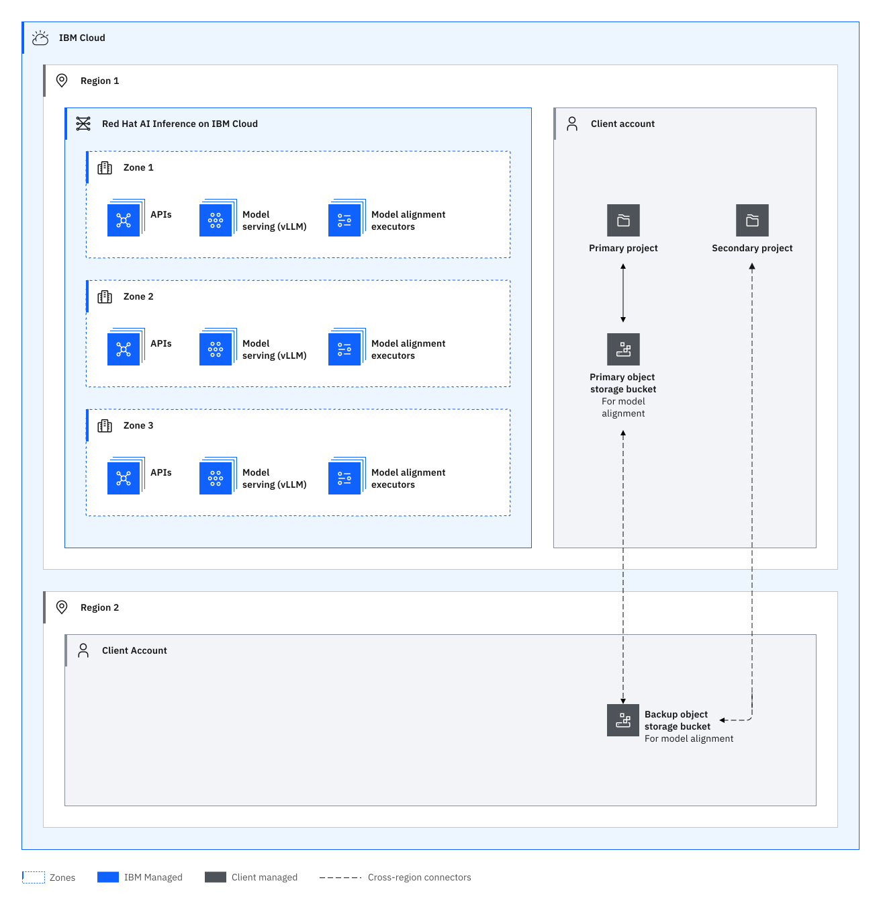

---

copyright:
  years: 2025, 2026
lastupdated: "2026-11-09"

keywords: HA for {{site.data.keyword.short_name}}, DR for {{site.data.keyword.short_name}}, {{site.data.keyword.short_name}} recovery time objective, {{site.data.keyword.short_name}} recovery point objective

subcollection: inference

---

{{site.data.keyword.attribute-definition-list}}

# Understanding high availability and disaster recovery for {{site.data.keyword.short_name}}
{: #ilab-ha-dr}

[High availability](#x2284708){: term} (HA) is the ability for a service to remain operational and accessible in the presence of unexpected failures. [Disaster recovery](#x2113280){: term} is the process of recovering the service instance to a working state.
{: shortdesc}

This topic contains specific information about the high availability and disaster recovery strategies and configurations for {{site.data.keyword.instructlab_short}}. For more information about how high availability and disaster recovery are handled for the {{site.data.keyword.cloud_notm}} platform, including concepts like cross regions, global services, and fault domains, check out the [Resiliency documentation](/docs/resiliency?topic=resiliency-ha-redundancy).
{: tip}

{{site.data.keyword.instructlab_short}} is a highly available regional service designed for availability during a zonal outage. {{site.data.keyword.instructlab_short}} is designed to meet the [Service Level Objectives (SLO)](/docs/resiliency?topic=resiliency-slo) with the Standard plan.

For more information about the available region and data center locations, see [Service and infrastructure availability by location](/docs/overview?topic=overview-services_region).

## High availability architecture
{: #ha-architecture}

{: caption="Architecture diagram" caption-side="bottom"}{: external download="high-availability-architecture-light.svg"}

### High availability features
{: #ha-features}

{{site.data.keyword.instructlab_short}} supports the following high availability features:

| Feature | Description | Consideration |
| --- | --- | --- |
| Global load balancing | When a node or availability zone fails, the service continues to run with API requests being routed through a global load balancer to the surviving HA instance nodes. | A brief delay of seconds exists between a failure and the global load balancer rerouting traffic. Requests sent during this interval are routed to the failed instance. |
| Active inference requests | Active requests are queued within {{site.data.keyword.instructlab_short}}, so even if the model is not available, the request is still processed. If requests are canceled on the client side, they continue to be processed on the backend and can be retrieved later.| N/A |
{: caption="HA features for {{site.data.keyword.instructlab_short}}" caption-side="bottom"}

## Disaster recovery features
{: #dr-features}

{{site.data.keyword.instructlab_short}} supports the following disaster recovery features:

| Feature | Description | Consideration |
| --- | --- | --- |
| {{site.data.keyword.short_name}} follows a regional deployment model. | In the case of a regional failure APIs could become unavailable until the region is restored. | - |
{: caption="DR features for {{site.data.keyword.instructlab_short}}" caption-side="bottom"}

### Planning for DR
{: #features-for-disaster-recovery}

The DR steps must be practiced regularly. As you build your plan, consider the following failure scenarios and resolutions.

| Failure | Resolution |
| -------------- | -------------- |
| Hardware failure (single point) | IBM provides an instance that's resilient from single point of hardware failure within a zone . No configuration required. |
| Zone failure | IBM provides an instance that's resilient from a zone failure. No configuration required. |
{: caption="DR scenarios" caption-side="bottom"}

## Your responsibilities for HA and DR
{: #feature-responsibilities}

It is your responsibility to continuously test your plan for HA and DR.

Interruptions in network connectivity and short periods of unavailability of a service might occur. It is your responsibility to make sure that application source code includes [client availability retry logic](/docs/resiliency?topic=resiliency-high-availability-design#client-retry-logic-for-ha) to maintain high availability of the application.
{: note}

For more information about responsibility ownership between you and {{site.data.keyword.cloud_notm}} for {{site.data.keyword.instructlab_short}}, see [Your responsibilities](/docs/inference?topic=inference-responsibilities).

## Change management
{: #change-management-hadr}

Change management includes tasks such as upgrades, configuration changes, and deletion.

Grant users and processes the IAM roles and actions with the least privilege that is required for their work. For more information, see [How can I prevent accidental deletion of services?](/docs/resiliency?topic=resiliency-dr-faq#prevent-accidental-deletion).
{: tip}

## How {{site.data.keyword.IBM_notm}} recovers from regional failures
{: #ibm-regional-failure}

If {{site.data.keyword.IBM_notm}} can’t restore the service instance, you must restore the service as described in the [Planning for disaster recovery](/docs/resiliency?topic=resiliency-PlanningforDR).

## How {{site.data.keyword.IBM_notm}} maintains services
{: #ibm-service-maintenance}

- All upgrades follow {{site.data.keyword.IBM_notm}} service best practices, including recovery plans and rollback processes.
- Regular maintenance might cause short interruptions, mitigated by [client availability retry logic](/docs/resiliency?topic=resiliency-high-availability-design#client-retry-logic-for-ha).
- Changes are rolled out sequentially, region by region, and zone by zone within a region. {{site.data.keyword.IBM_notm}} reverts updates at the first sign of a defect.
- Complex changes are enabled and disabled with feature flags to control exposure.
- Changes that impact customer workloads are detailed in {{site.data.keyword.cloud_notm}} notifications.

For more information about planned maintenance, announcements, and release notes that impact this service, see the [{{site.data.keyword.short_name}} release notes](/docs/inference?topic=inference-release-notes).
